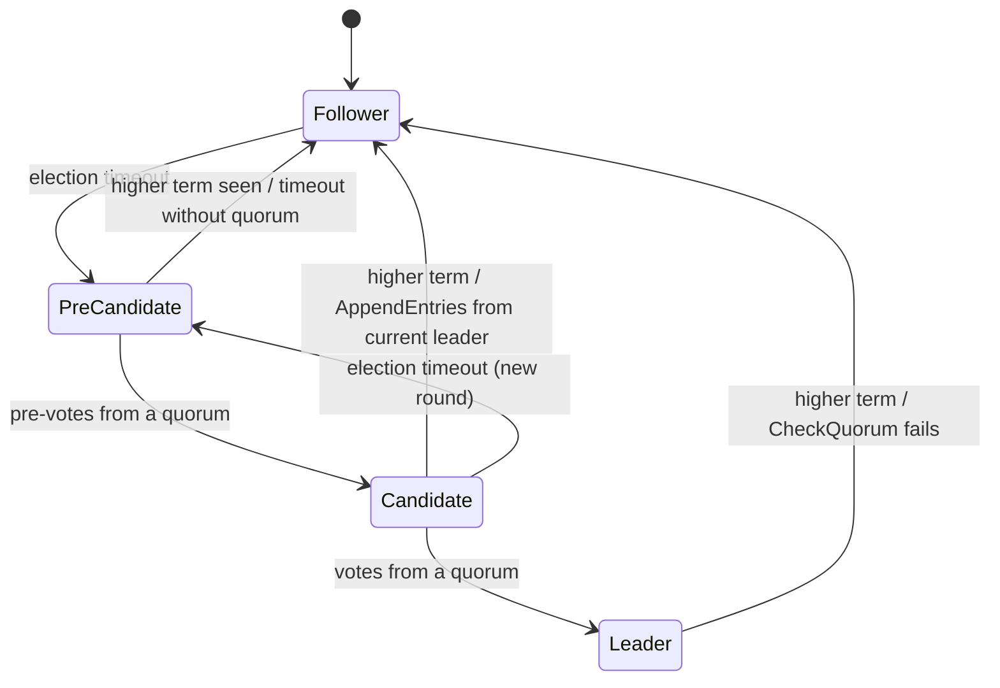
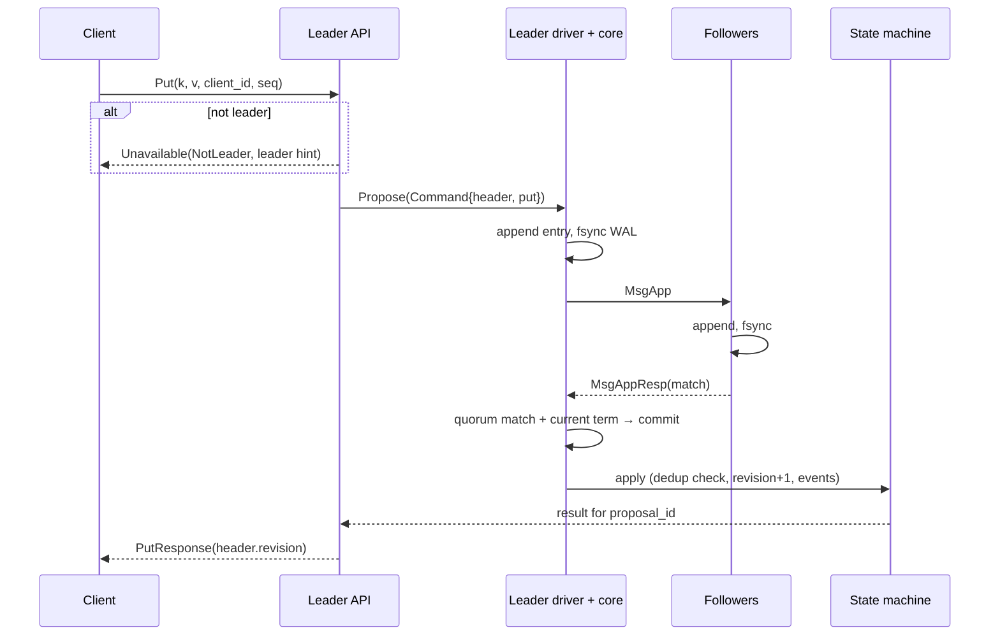

# Ballast — Specification

**A Raft-based coordination service in Go.** This file is the single source of truth for the project. Code, tests and AI agents follow it. If code and spec disagree, either the code is wrong or the spec gets a recorded change (§20).

Status: v1 spec, 14 Nov 2026 · Owner: Gaurav Maurya

---

## Contents

1. [Goal and non-goals](#1-goal-and-non-goals)
2. [Decisions](#2-decisions)
3. [Glossary](#3-glossary)
4. [System architecture](#4-system-architecture)
5. [Fault model](#5-fault-model)
6. [Raft core: API](#6-raft-core-api)
7. [Raft core: behaviour](#7-raft-core-behaviour)
8. [Driver loop](#8-driver-loop)
9. [Storage: WAL and snapshots](#9-storage-wal-and-snapshots)
10. [State machine: MVCC KV, leases, sessions](#10-state-machine-mvcc-kv-leases-sessions)
11. [Pipelines (end to end)](#11-pipelines-end-to-end)
12. [Invariants](#12-invariants)
13. [Client API (gRPC proto)](#13-client-api-grpc-proto)
14. [Peer transport](#14-peer-transport)
15. [CLI tools](#15-cli-tools)
16. [Scheduler demo](#16-scheduler-demo)
17. [Testing specification](#17-testing-specification)
18. [Observability](#18-observability)
19. [Configuration defaults](#19-configuration-defaults)
20. [Repo layout, ownership and change log](#20-repo-layout-ownership-and-change-log)

---

## 1. Goal and non-goals

**Goal.** A 3- or 5-node cluster that stores small, critical data (locks, config, service registry) and stays correct under crashes, partitions and message loss. While a majority of nodes is up and connected it keeps serving. It never loses an acknowledged write and never returns a stale read.

**Proof the project must produce**

- Linearizable client histories across 10,000 randomised fault runs (Porcupine).
- A job scheduler with 3 instances that uses Ballast locks: no time slot ever recorded twice, none skipped, under chaos.
- YCSB benchmark numbers with explanations.

**Non-goals (v1).** Adding or removing nodes while running, sharding, multi-key transactions (except the guarded write in §10.4), TLS/authentication, Byzantine faults, disk-corruption repair, running on more than one machine, cloud deployment.

## 2. Decisions

| # | Topic | Decision | Reason |
|---|---|---|---|
| D1 | Language | Go 1.24+ | Ecosystem (etcd, Porcupine), goroutines |
| D2 | Core design | Pure state machine with no I/O, driven by a driver loop (etcd/raft style) | Deterministic simulation testing |
| D3 | Raft extensions | **Pre-vote** and **CheckQuorum** in v1; no leader transfer | Stops disruptive elections; a cut-off leader steps down |
| D4 | Reads | **ReadIndex** (linearizable, no log write) | Fast reads that are still correct |
| D5 | Data model | **MVCC with global revisions** (etcd-like) | Needed for watch from a past revision and as fencing tokens |
| D6 | Watch | From any revision ≥ compact revision; never misses events | Clients that reconnect resume without gaps |
| D7 | Leases | **Lease objects** with TTL; keys attach to a lease; expiry is proposed by the leader through the log | Locks free themselves; apply stays deterministic |
| D8 | Operations | Put, Get, **Range by prefix**, Delete (key or prefix), CAS, guarded write (several compares + one write) | Service discovery + correct fencing for locks |
| D9 | Client API | **gRPC only** | One typed API |
| D10 | Client redirects | Followers reply `NotLeader` with a leader hint; the client library redirects | Simpler than proxying |
| D11 | Duplicate protection | Client ID + sequence number, one outstanding write per client ID | Retries never apply twice |
| D12 | Storage | Own segmented WAL with CRC + fsync; snapshot files | Learning goal; no storage library |
| D13 | Deployment | Docker Compose on one machine; Toxiproxy for network faults | Enough to prove fault tolerance |
| D14 | Membership | Fixed at bootstrap (3 or 5 nodes) | Membership changes are out of scope |

## 3. Glossary

| Term | Meaning |
|---|---|
| Term | Raft's logical clock. Each election starts a new term. At most one leader per term. |
| Log entry | `(index, term, data)`. Indexes start at 1. |
| Committed | Stored on a majority. Never lost or changed after that. |
| Applied | Executed on the state machine (the KV store). Always ≤ committed. |
| Quorum / majority | ⌊n/2⌋ + 1 nodes (2 of 3, 3 of 5). |
| Revision | Ballast's global version counter. Increases by 1 for each state-changing applied command. |
| Lease | A server-side timer object with a TTL. Keys attached to it are deleted when it expires. |
| Fencing token | A number that only increases (here the lock key's `create_revision`), used to reject a stale lock holder. |
| Tick | One step of the logical clock passed to the Raft core. 10 ms in production. |
| Linearizable | Every operation appears to happen at one instant between its call and its return, consistent with real-time order. |

## 4. System architecture

```
                 ┌──────────────────────────────┐
                 │ Clients: ballastctl, client  │
                 │ library, scheduler demo      │
                 └──────────────┬───────────────┘
                                │ gRPC (KV, Lease, Watch, Maintenance)
┌───────────────────────────────▼──────────────────────────────────────┐
│ ballast node (one of N)                                              │
│                                                                      │
│  ┌──────────────────────┐   propose / read   ┌────────────────────┐  │
│  │ API server (grpc)    │──────────────────► │ Request tracker    │  │
│  └──────────┬───────────┘ ◄──── results ─────│ (waits per index / │  │
│             │ watch streams                  │  read ctx)         │  │
│  ┌──────────▼───────────┐                    └─────────┬──────────┘  │
│  │ Watch hub            │◄── events ──┐                │             │
│  └──────────────────────┘             │                │             │
│  ┌──────────────────────┐   apply     │      ┌─────────▼──────────┐  │
│  │ State machine        │◄────────────┼──────│ Driver loop        │  │
│  │ MVCC KV, leases,     │─────────────┘      │ tick → step →      │  │
│  │ sessions             │                    │ Ready → persist →  │  │
│  └──────────────────────┘                    │ send → apply →     │  │
│  ┌──────────────────────┐                    │ Advance            │  │
│  │ Lease timer (leader) │── LeaseRevoke ────►└──┬──────┬──────┬───┘  │
│  └──────────────────────┘                       │      │      │      │
│                                        ┌────────▼┐ ┌───▼────┐ ┌▼────┐│
│                                        │Raft core│ │Storage │ │Clock││
│                                        │(no I/O) │ │WAL+snap│ │ticks││
│                                        └─────────┘ └────────┘ └─────┘│
│                                        ┌──────────────────────┐      │
│                                        │ Transport (gRPC peer)│      │
│                                        └──────────┬───────────┘      │
└───────────────────────────────────────────────────┼──────────────────┘
                                                    ▼
                                             other N−1 nodes
```

**Components and responsibilities**

| Component | Package | Responsibility | Must not |
|---|---|---|---|
| Raft core | `raft/` | Election, replication, commit, ReadIndex, snapshots (decisions only) | Do I/O, read time, start goroutines, use global randomness |
| Driver | `node/` | Feeds ticks and messages in; carries out Ready in the required order (§8) | Contain Raft decisions |
| Storage | `storage/wal`, `storage/snap`, `storage/mem` | Durable log, hard state, snapshots; in-memory copy for tests | Interpret entries |
| State machine | `kv/` | MVCC store, revisions, leases, sessions, CAS, guarded writes | Read wall-clock time or randomness while applying |
| Watch hub | `kv/watch` | Fans applied events out to watchers; catch-up from history | Block apply |
| Lease timer | `kv/lease` | Leader-only expiry tracking; proposes revokes | Delete keys directly |
| Request tracker | `node/` | Maps proposal IDs and read contexts to waiting gRPC calls | Hold locks across apply |
| API server | `server/` | gRPC services; leader checks; redirects | Bypass Raft for writes |
| Transport | `transport/grpc`, `transport/sim` | Delivers `raft.Message`s between nodes | Guarantee delivery |
| Client library | `client/` | Finds the leader, redirects, retries with the same sequence number, keeps leases alive, resumes watches | Retry with a new sequence number |

## 5. Fault model

What Ballast must survive (and what tests inject):

| Fault | Included | Notes |
|---|---|---|
| Process crash + restart | Yes | Anything fsync'd survives; anything not synced is lost |
| Crash at any point inside the driver loop | Yes | Between persist and send, between send and apply, etc. |
| Message loss, delay, duplication, reordering | Yes | Per link, random |
| Network partition (symmetric) | Yes | Any split, including leader isolated |
| Asymmetric partition (A→B works, B→A doesn't) | Yes | CheckQuorum and pre-vote are tested here |
| Clock drift between nodes | Yes, bounded | Tick rates differ by up to ±10% per node |
| Torn write at the WAL tail | Yes | Detected by CRC on restart, tail truncated |
| Corruption in the middle of the WAL or a snapshot | Detected only | Node refuses to start; not repaired |
| Byzantine (lying) nodes | No | |
| Losing more than a minority at once | Only temporarily | No progress until a majority is back; never unsafe |

## 6. Raft core: API

The core is a deterministic state machine: the same inputs and the same `Rand` seed produce exactly the same outputs.

```go
package raft

type NodeID uint64

type Role uint8
const (
    Follower Role = iota
    PreCandidate
    Candidate
    Leader
)

type EntryType uint8
const (
    EntryNormal EntryType = iota // Data = encoded kv.Command
    EntryNoOp                    // appended by a new leader at the start of its term
)

type Entry struct {
    Index uint64
    Term  uint64
    Type  EntryType
    Data  []byte
}

// HardState is persisted before any message that depends on it is sent.
type HardState struct {
    Term   uint64
    Vote   NodeID // 0 = none
    Commit uint64
}

type SnapshotMeta struct {
    Index uint64   // last log index the snapshot includes
    Term  uint64   // term of that entry
    Peers []NodeID // cluster members (fixed in v1)
}

type Snapshot struct {
    Meta SnapshotMeta
    Data []byte // opaque to raft: encoded kv state (§10.7)
}

type MsgType uint8
const (
    MsgPreVote MsgType = iota
    MsgPreVoteResp
    MsgVote
    MsgVoteResp
    MsgApp           // AppendEntries
    MsgAppResp
    MsgHeartbeat
    MsgHeartbeatResp
    MsgSnap          // InstallSnapshot (whole snapshot in one message in v1)
)

type Message struct {
    Type MsgType
    From NodeID
    To   NodeID
    Term uint64 // sender's term; PreVote carries term+1 without the sender changing its term

    // Vote / PreVote: last log index and term of the candidate.
    // App: prevLogIndex and prevLogTerm.
    LogIndex uint64
    LogTerm  uint64

    Entries []Entry
    Commit  uint64 // leader's commit index (App, Heartbeat)

    Reject     bool
    RejectHint uint64 // AppResp reject: follower's last index, for fast backtracking

    Index uint64 // AppResp accept: highest index the follower now matches

    Context  []byte    // ReadIndex context, echoed in Heartbeat / HeartbeatResp
    Snapshot *Snapshot // MsgSnap only
}

type SoftState struct { // not persisted
    Lead NodeID
    Role Role
}

type ReadState struct {
    Index      uint64 // commit index confirmed by a quorum for this read
    RequestCtx []byte
}

// Ready is everything the driver must do, in the order of §8.
type Ready struct {
    SoftState        *SoftState // nil if unchanged
    HardState        *HardState // nil if unchanged
    Snapshot         *Snapshot  // received from the leader: persist, then apply
    Entries          []Entry    // persist BEFORE sending Messages
    Messages         []Message
    CommittedEntries []Entry    // already persisted, safe to apply
    ReadStates       []ReadState
}

type Status struct {
    ID          NodeID
    Role        Role
    Term        uint64
    Lead        NodeID
    Commit      uint64
    Applied     uint64
    LastIndex   uint64
    Progress    map[NodeID]Progress // leader only
}

type Progress struct{ Match, Next uint64; RecentActive bool }

// Storage is read-only from the core's point of view.
type Storage interface {
    InitialState() (HardState, SnapshotMeta, error)
    Entries(lo, hi uint64) ([]Entry, error) // [lo, hi); ErrCompacted, ErrUnavailable
    Term(i uint64) (uint64, error)
    FirstIndex() (uint64, error) // first index still in the log (snapshot.Index+1)
    LastIndex() (uint64, error)
    Snapshot() (Snapshot, error)
}

type Config struct {
    ID               NodeID
    Peers            []NodeID // includes ID
    ElectionTicks    int      // E: timeout is random in [E, 2E)
    HeartbeatTicks   int      // must be < ElectionTicks
    Storage          Storage
    Applied          uint64   // last applied index after restart
    PreVote          bool     // true in v1
    CheckQuorum      bool     // true in v1
    MaxSizePerMsg    uint64   // bytes of entries per MsgApp
    MaxInflightMsgs  int      // unacknowledged MsgApp per follower
    Rand             *rand.Rand // seeded; the only source of randomness
}

type Core interface {
    Tick()
    Step(m Message) error        // incoming peer message
    Propose(data []byte) error   // ErrNotLeader, ErrProposalDropped
    ReadIndex(ctx []byte)        // result arrives as Ready.ReadStates
    HasReady() bool
    Ready() Ready
    Advance(rd Ready)            // called after the driver has carried out rd
    Status() Status
}

func New(cfg Config) (Core, error)

var (
    ErrNotLeader       = errors.New("raft: not leader")
    ErrProposalDropped = errors.New("raft: proposal dropped")
    ErrCompacted       = errors.New("raft: requested index is compacted")
    ErrUnavailable     = errors.New("raft: requested entry not available")
)
```

## 7. Raft core: behaviour

Base rules: Figure 2 of the Raft paper, followed exactly. This section adds the v1 extensions and the details Figure 2 leaves open.

### 7.1 Roles and transitions



### 7.2 Timers

- Each node keeps `electionElapsed` and a randomised `electionTimeout` in `[E, 2E)`, re-drawn from `cfg.Rand` every time the timer resets.
- Followers and candidates reset the timer when they grant a vote or receive a valid MsgApp/MsgHeartbeat from the current leader.
- The leader sends a heartbeat every `HeartbeatTicks`.

### 7.3 Pre-vote

1. On timeout, a follower becomes **PreCandidate**. It does **not** increment its term or change its vote.
2. It sends `MsgPreVote{Term: currentTerm+1, LogIndex: last, LogTerm: lastTerm}` to all peers.
3. A peer grants a pre-vote if **all three** hold:
   - `m.Term > peer's currentTerm` (the proposed term is new to it),
   - the candidate's log is at least as up to date as its own (§5.4.1 of the paper), and
   - it has not heard from a valid leader within its own minimum election timeout (`E` ticks).

   The response carries `Term = m.Term` if granted, or the peer's own term if rejected.
4. Responding to a pre-vote changes nothing in the responder's persisted state.
5. With pre-votes from a quorum (counting itself) → becomes Candidate and runs a normal election.

### 7.4 Election (candidate)

1. `term++`, `vote = self`, persist HardState (through Ready), reset the timer.
2. Send `MsgVote` with last log index and term.
3. A voter grants if: `m.Term ≥ term`, it hasn't voted for someone else in this term, and the candidate's log is up to date. Under CheckQuorum, a voter that heard from a leader within `E` ticks **ignores** the request (leader stickiness).
4. A quorum of votes → Leader.

### 7.5 Becoming leader

1. `next[p] = last+1`, `match[p] = 0` for every peer; `match[self] = last`.
2. Append an `EntryNoOp` in the new term immediately. The leader can't count replicas for older-term entries (Figure 8), so nothing from earlier terms commits until this no-op commits. ReadIndex also waits for it (§7.8).

### 7.6 Replication

- The leader sends MsgApp from `next[p]`, at most `MaxSizePerMsg` bytes, and at most `MaxInflightMsgs` unacknowledged batches per follower.
- **Follower on MsgApp:** reject if it lacks `prevLogIndex` or the term there differs, setting `RejectHint = min(lastIndex, prevLogIndex-1)`. Otherwise find the first conflicting entry, truncate from there, append the new entries, set `commit = min(m.Commit, index of last new entry)`.
- **Leader on accept:** `match[p] = max(match[p], m.Index)`, `next[p] = match[p]+1`.
- **Leader on reject:** `next[p] = min(next[p]-1, m.RejectHint+1)`, at least 1.
- If `next[p] ≤ snapshot.Index` (entries compacted), send MsgSnap instead.

### 7.7 Commit rule

The leader sets `commit = N` for the largest `N` where a quorum has `match ≥ N` **and** `log[N].term == currentTerm`. Commit never decreases.

### 7.8 ReadIndex

1. The leader receives `ReadIndex(ctx)`.
2. If no entry of the current term is committed yet (the no-op), it queues the request until one is.
3. It records `readIndex = commit`, then sends a heartbeat round carrying `Context = ctx`.
4. Once a quorum (counting itself) has replied with that context, it emits `ReadState{Index: readIndex, RequestCtx: ctx}`.
5. The driver serves the read once `applied ≥ readIndex`.
6. A follower that gets `ReadIndex` returns `ErrNotLeader`; the API layer redirects (D10).
7. Several read requests waiting for the same round may share one heartbeat round.

### 7.9 CheckQuorum

- The leader marks a peer `RecentActive` when any message from it arrives.
- Every `E` ticks, the leader counts active peers (counting itself). If fewer than a quorum, it **steps down to Follower** in the same term, then clears all `RecentActive` flags.

### 7.10 Term handling (every message)

- `m.Term > term` → become Follower in `m.Term` with `vote = 0`, then process the message. **Exceptions:** MsgPreVote never changes the term. Under CheckQuorum, a MsgVote/MsgPreVote that arrives within `E` ticks of hearing from the leader is ignored without changing the term.
- `m.Term < term` → reject (respond with the current term so the sender steps down), except stale responses, which are dropped.

### 7.11 Snapshots in the core

- The driver tells the core when a snapshot has been taken (via Storage). The core can then send MsgSnap to followers whose `next` falls below the log's first index.
- A follower receiving MsgSnap whose `Meta.Index` is beyond its commit index puts it in `Ready.Snapshot`, resets its log to start after `Meta.Index`, and sets `commit = Meta.Index`. If `Meta.Index ≤ commit`, it ignores it and replies with its last index.

## 8. Driver loop

One goroutine per node owns the core. Nothing else calls the core.

```go
for {
    select {
    case <-ticker.C:              core.Tick()
    case m := <-transport.Recv(): core.Step(m)
    case p := <-proposals:        core.Propose(p.data)   // ErrNotLeader → answer p now
    case r := <-reads:            core.ReadIndex(r.ctx)
    case <-stop:                  return
    }
    for core.HasReady() {
        rd := core.Ready()
        // 1. Durability first
        if rd.Snapshot != nil { storage.SaveSnapshot(*rd.Snapshot) }   // fsync
        storage.Append(rd.Entries)                                     // truncates on conflict
        if rd.HardState != nil { storage.SetHardState(*rd.HardState) }
        storage.Sync()                                                 // ONE fsync for the batch
        // 2. Only now talk to peers
        transport.Send(rd.Messages)
        // 3. Apply
        if rd.Snapshot != nil { sm.Restore(rd.Snapshot.Data) }
        for _, e := range rd.CommittedEntries { res := sm.Apply(e); tracker.Complete(e.Index, res) }
        for _, rs := range rd.ReadStates { tracker.ReadReady(rs) }     // served once applied ≥ rs.Index
        // 4. Bookkeeping
        if rd.SoftState != nil { onRoleChange(*rd.SoftState) }         // lease timer, metrics
        maybeSnapshot()                                                // §9.3
        core.Advance(rd)
    }
}
```

**Required order (an invariant, §12.2):** persist + fsync → send → apply → Advance. Sending a vote or append response before fsync can lead to two leaders in one term after a crash.

**Proposal tracking.** Each proposal carries a unique ID inside the encoded command. The tracker waits for an applied entry with that ID. If the node loses leadership (SoftState change) or the wait times out, the call fails with `Unavailable`, and the client retries **with the same sequence number** (§10.5).

## 9. Storage: WAL and snapshots

### 9.1 Directory layout

```
<data-dir>/
  wal/
    0000000000000001-0000000000000001.wal   # <segment seq>-<first index in segment>
    0000000000000002-0000000000010001.wal
  snap/
    0000000000000003-0000000000010000.snap  # <term>-<index>
  LOCK                                       # flock held while running
```

### 9.2 WAL record format

```
┌────────────┬────────────┬──────────┬───────────────────────┐
│ length u32 │ crc32c u32 │ type u8  │ payload (length bytes)│
└────────────┴────────────┴──────────┴───────────────────────┘
  little-endian; crc32c (Castagnoli) over type || payload
```

| Type | Payload | Meaning on replay |
|---|---|---|
| 1 `Entry` | encoded `raft.Entry` | If `Index ≤` last replayed index, discard everything from `Index` onwards first (truncation), then append |
| 2 `HardState` | encoded `HardState` | Latest one wins |
| 3 `SnapshotMarker` | `(index, term)` | Log starts after this point; earlier entries ignored |
| 4 `SegmentHeader` | `(format version, first index)` | First record of each segment |

**Rules**

- Segments roll at 64 MiB. A new segment begins with SegmentHeader and the latest HardState.
- `Sync()` = `fsync` on the current segment file. Creating or rolling a segment also fsyncs the `wal/` directory.
- **On replay:** a bad CRC or a short record **in the last segment, at its tail** = a torn write, so truncate the file there and continue. A bad CRC anywhere else = corruption, so refuse to start.
- **Compaction:** after a snapshot at index S, delete whole segments whose last index ≤ S (keeping at least one segment).

### 9.3 Snapshots

- **When:** `applied − lastSnapshotIndex ≥ SnapshotEntries` (default 10,000).
- **How:** `sm.Snapshot()` produces bytes at the applied index. Write to `snap/tmp-*`, fsync, rename to `<term>-<index>.snap`, fsync `snap/`. Then write a WAL SnapshotMarker, call `storage.Compact(index)`, and delete old WAL segments and all but the 2 newest snapshots.
- **File format:** `magic "BSNP" | version u16 | crc32c u32 | meta (index, term, peers) | data`.
- **Restart:** load the newest valid snapshot (skip ones with a bad CRC), `sm.Restore(data)`, replay WAL entries after `meta.Index`, then build the core with `Applied = meta.Index`. Committed entries after it get applied again through Ready (apply is deterministic, §12.3).

## 10. State machine: MVCC KV, leases, sessions

### 10.1 Command encoding (the payload of Raft log entries)

Commands are protobuf messages (`kv/kvpb`), so every node decodes them byte-for-byte identically.

```proto
message Command {
  RequestHeader header = 1;           // client_id, seq, proposal_id
  oneof op {
    PutOp          put           = 10;
    DeleteOp       delete        = 11;
    GuardedWriteOp guarded_write = 12; // includes CAS
    LeaseGrantOp   lease_grant   = 13;
    LeaseRevokeOp  lease_revoke  = 14;
    CompactOp      compact       = 15;
  }
}
message RequestHeader { bytes client_id = 1; uint64 seq = 2; uint64 proposal_id = 3; }
```

### 10.2 Data model

```go
type KeyValue struct {
    Key            []byte
    Value          []byte
    CreateRevision int64 // revision when this key was created (since its last deletion)
    ModRevision    int64 // revision of the last change
    Version        int64 // number of changes since creation (1 = just created)
    Lease          int64 // 0 = none
}

type Event struct {
    Type   EventType // PUT or DELETE
    KV     KeyValue  // for DELETE: key, and ModRevision = revision of the delete
    PrevKV *KeyValue
}
```

- **Current state:** ordered map `key → KeyValue` (a B-tree, `github.com/google/btree`), so prefix ranges are ordered scans.
- **Revision:** `int64`, starts at 1 (empty store). Each applied command that changes state increments it by **exactly 1**. Every event from that command (for example all keys removed by a prefix delete or a lease revoke) shares that revision. Commands that change nothing (failed CAS, no-op entries, duplicates) don't increment it.
- **History:** a ring of `(revision, []Event)` covering `(compactRevision, currentRevision]`. Used only by watch.
- **History compaction:** automatic, keeping the last `HistoryRevisions` (default 10,000) revisions. It runs inside apply, triggered by the revision number, so it's deterministic. A `CompactOp` can compact further.

### 10.3 Operations (apply semantics)

| Op | Effect | Revision change |
|---|---|---|
| `Put(key, value, lease)` | Create or update. Create: `CreateRevision = ModRevision = rev`, `Version = 1`. Update: keep `CreateRevision`, `Version++`. If `lease ≠ 0`, the lease must exist (else error, no change); the key moves from its old lease to the new one. | +1 |
| `Delete(key)` / `Delete(prefix)` | Remove the matching keys; one DELETE event each; detach them from leases | +1 if ≥1 key removed |
| `Range(key)` / `Range(prefix, limit)` | Read only; not a log entry (ReadIndex, §11.3) | none |
| `GuardedWrite(compares[], write)` | If **all** compares hold, apply `write` (a Put or a single-key Delete); return `succeeded` | +1 only if it succeeded and changed something |
| `LeaseGrant(ttl)` | Create a lease. **ID = Raft index of this entry** (deterministic). | +0 (leases aren't KV events) |
| `LeaseRevoke(id)` | Delete every key attached to the lease (one revision), then drop the lease | +1 if it had keys |
| `Compact(rev)` | Drop history ≤ rev; `rev` must be ≤ current | none |

**Compare** = `{key, target ∈ {VALUE, VERSION, CREATE_REVISION, MOD_REVISION, LEASE}, op ∈ {EQUAL, NOT_EQUAL, LESS, GREATER}, operand}`. A missing key has `Version = CreateRevision = ModRevision = 0`. **CAS** is a GuardedWrite with one compare. "Create if absent" = compare `CREATE_REVISION EQUAL 0`.

### 10.4 Why guarded writes with several compares

Fencing: a lock holder's write must succeed only if it still holds the lock. The scheduler's job write is `GuardedWrite(compares: [slot key CREATE_REVISION == 0, lock key CREATE_REVISION == myToken], write: Put(slot))`. That needs two compares on two keys but only one write. This is the only multi-key feature in v1. It is not a general transaction.

### 10.5 Client sessions (duplicate protection)

- The client generates a random 128-bit `client_id` once per process and numbers its writes `seq = 1, 2, 3…`, **with at most one write in flight per client ID**. The library serialises writes, or uses several IDs to run writes in parallel.
- The state machine keeps `sessions[client_id] = {lastSeq, lastResponse, lastIndex}`.
- **On apply:**
  - `seq ≤ lastSeq` → return the cached `lastResponse` if `seq == lastSeq`; if `seq < lastSeq`, return the error `StaleSequence`. No state change.
  - Otherwise, apply, store the response, and set `lastSeq = seq`.
- **Session expiry (deterministic):** while applying entry at index `i`, delete sessions with `lastIndex < i − SessionEntries` (default 100,000). A client that returns after expiry with an old seq could get a duplicate apply; this is a documented limitation.
- Lease KeepAlive is not a log command, so it needs no session.

### 10.6 Leases

- **Grant / revoke / attach** go through the log (deterministic).
- **Expiry timing is leader-local and not replicated.** The leader keeps `expiry[id] = now + ttl` (monotonic clock). `KeepAlive(id)` RPCs go to the leader and reset the expiry. A background loop on the leader proposes `LeaseRevoke(id)` for each expired lease.
- **Followers never expire leases.**
- **New leader:** on becoming leader, set `expiry[id] = now + ttl` for every lease. This extends leases, never shortens them. That's the safe direction: a lock can be held slightly longer than its TTL, never shorter.
- **Minimum TTL:** `MinLeaseTTL` (default 2 s), more than one election timeout + one heartbeat. Requests below it get the minimum.
- **Client keep-alive interval:** TTL/3.

### 10.7 State snapshot contents (`kvpb.StateSnapshot`)

`current revision, compact revision, all KeyValues (sorted by key), history window, leases (id, ttl, attached keys), sessions`. It's encoded deterministically, so the same state gives the same bytes. `StateHash()` = CRC-64 of those bytes. The simulation compares it across nodes at the same applied index.

### 10.8 Watch hub

- **Watch(key | prefix, startRevision):**
  - `startRevision == 0` → events after the current revision.
  - `startRevision ≤ compactRevision` → cancelled with `ErrCompacted{compactRevision}`.
  - Otherwise, first replay history from `startRevision`, then stream live events.
- **Ordering:** each watcher gets events in strictly increasing revision order, with no gaps between its start and now. Events sharing one revision arrive in one response.
- **Slow watcher:** each has a buffer of 1,024 responses. If the buffer is full, the watcher switches to catch-up mode, reading from history. If it falls behind the compact revision, it's cancelled with `ErrCompacted`, and the client re-watches after doing a fresh Range.
- **Any node can serve watches,** since events come from its own apply in log order. Watches lag the leader slightly, but they're always ordered and never miss events.

## 11. Pipelines (end to end)

### 11.1 Write (Put / Delete / GuardedWrite / LeaseGrant / LeaseRevoke)



**Failure points**
- Leader crashes after commit but before replying → the client times out and retries with the same seq → the new leader's state machine returns the cached response.
- Leader crashes before commit → the entry may be overwritten → the retry applies it once.

### 11.2 Election with pre-vote

1. Follower timeout → PreCandidate → MsgPreVote (term+1) to all.
2. Pre-votes from a quorum → Candidate: term++, vote self, **persist**, MsgVote to all.
3. Votes from a quorum → Leader: append no-op, heartbeat immediately.
4. No-op commits → leader can serve ReadIndex and count old entries as committed.

### 11.3 Linearizable read (Range) via ReadIndex

1. Client → any node. A follower redirects (D10).
2. Leader API → `ReadIndex(ctx)` through the driver.
3. Core: wait for the current-term no-op to commit → `readIndex = commit` → heartbeat with ctx → quorum ack → `ReadState`.
4. Driver: wait until `applied ≥ readIndex` → run the Range on the state machine → reply with `header.revision`.

### 11.4 Lease lifecycle and lock

1. `LeaseGrant(ttl)` → log → lease ID = entry index.
2. Lock = `GuardedWrite([lockKey CREATE_REVISION == 0], Put(lockKey, owner, lease=id))`. If it succeeds, `token = header.revision`, which becomes the key's CreateRevision.
3. The holder calls `KeepAlive(id)` every TTL/3, always on the leader.
4. If the holder dies → keep-alives stop → leader timer expires → `LeaseRevoke(id)` through the log → lock key deleted (DELETE event).
5. Standby instances watching `lockKey` see the DELETE → retry step 2.

### 11.5 Watch

Client → `Watch(prefix, startRev)` on any node → replay from history → live events from apply. If the stream breaks, the client library reconnects with `startRev = lastSeenRevision + 1`.

### 11.6 Snapshot install to a lagging follower

Leader sees `next[p] ≤ firstIndex − 1` → MsgSnap with the latest snapshot. The follower persists the snapshot (temp file + rename + fsync), restores its state machine, resets its log, and replies `MsgAppResp{Index: meta.Index}`. The leader resumes MsgApp from `meta.Index + 1`.

### 11.7 Restart and recovery

Take the LOCK file → load the newest valid snapshot → replay the WAL (truncating a torn tail) → `sm.Restore` → build the core from Storage (`Applied = snapshot index`) → start the driver. The core then re-delivers committed-but-unapplied entries.

## 12. Invariants

Each invariant has an ID that tests and the bug journal refer to. **Checked by:** S = simulation checker after every step · P = Porcupine · A = runtime assertion (crash with full state if violated) · C = chaos test.

### 12.1 Raft safety (from the paper)

| ID | Invariant | Checked by |
|---|---|---|
| R1 Election Safety | At most one leader per term | S, A |
| R2 Leader Append-Only | A leader never overwrites or deletes entries in its log | A |
| R3 Log Matching | If two logs have an entry with the same index and term, the logs are identical up to that index | S |
| R4 Leader Completeness | Every committed entry is in the log of every leader of a later term | S |
| R5 State Machine Safety | No two nodes apply different entries at the same index | S |

### 12.2 Implementation invariants

| ID | Invariant | Checked by |
|---|---|---|
| I1 | A node's `term` never decreases, including across restarts | S, A |
| I2 | At most one vote per node per term, including across restarts | S, A |
| I3 | `applied ≤ commit ≤ lastIndex` on every node | A |
| I4 | `commit` never decreases on any node | S, A |
| I5 | The leader counts replicas only for current-term entries (Figure 8) | Unit test |
| I6 | Vote and append responses are sent only after the HardState and entries they depend on are fsync'd | S (crash between persist and send) |
| I7 | Pre-vote never changes the term or vote of any node | S |
| I8 | A leader that can't reach a quorum for `E` ticks steps down | S |
| I9 | A ReadState is emitted only after a quorum acknowledged that read's heartbeat round in the leader's current term | S |
| I10 | A snapshot's index ≤ the commit index of the node that took it | A |
| I11 | The core is deterministic: same seed + same inputs give the same Ready sequence | S (run each seed twice, compare) |

### 12.3 State machine invariants

| ID | Invariant | Checked by |
|---|---|---|
| K1 | Apply is deterministic: same entries in the same order give the same `StateHash` | S (hash compared across nodes at each applied index) |
| K2 | The revision increases by exactly 1 per state-changing command and never decreases | S, A |
| K3 | Each `(client_id, seq)` changes state at most once | S |
| K4 | Linearizability: client-observed Put/Get/Delete/CAS histories have a valid sequential order consistent with real time | P |
| K5 | A read via ReadIndex reflects every write acknowledged before the read was sent | P |
| K6 | `CreateRevision ≤ ModRevision ≤ current revision`; `Version ≥ 1` for existing keys | A |
| K7 | Keys attached to a revoked lease are gone in the same revision as the revoke | S |
| K8 | Only applied `LeaseRevoke` entries delete lease keys; followers never expire leases on their own | Code review + S |
| K9 | A lease is never revoked for expiry before `ttl` has passed since the last keep-alive the revoking leader saw | S (simulated clock) |

### 12.4 Watch invariants

| ID | Invariant | Checked by |
|---|---|---|
| W1 | Each watcher sees strictly increasing revisions | S |
| W2 | No gaps: a watcher from `startRev` sees every matching event in `[startRev, current]` | S (compared against history) |
| W3 | Watching from `startRev ≤ compactRevision` always returns `ErrCompacted` | Unit test |

### 12.5 Scheduler invariants (demo)

| ID | Invariant | Checked by |
|---|---|---|
| J1 | At most one record per slot | C |
| J2 | Every slot in the run window gets a record by the end of the run | C |
| J3 | Fencing tokens in slot records never decrease as the slot number increases | C |

### 12.6 Liveness (holds only when the network is healthy)

| ID | Property | Checked by |
|---|---|---|
| L1 | With a connected majority and no faults for `4E` ticks, a leader exists | S |
| L2 | A proposal on a stable leader commits within `2 × heartbeat` ticks plus delivery delay | S |
| L3 | After healing, a rejoined node's log matches the leader's within `10E` ticks | S |

## 13. Client API (gRPC proto)

`api/ballastpb/ballast.proto`

```proto
syntax = "proto3";
package ballast.v1;
option go_package = "github.com/GauravMaurya04/Ballast/api/ballastpb";

message ResponseHeader {
  int64  revision  = 1; // store revision when the request was served
  uint64 raft_term = 2;
  uint64 member_id = 3;
  uint64 leader_id = 4;
}
message RequestHeader { bytes client_id = 1; uint64 seq = 2; } // writes only

message KeyValue {
  bytes key = 1; bytes value = 2;
  int64 create_revision = 3; int64 mod_revision = 4; int64 version = 5; int64 lease = 6;
}

service KV {
  rpc Range(RangeRequest)               returns (RangeResponse);
  rpc Put(PutRequest)                   returns (PutResponse);
  rpc Delete(DeleteRequest)             returns (DeleteResponse);
  rpc GuardedWrite(GuardedWriteRequest) returns (GuardedWriteResponse);
}
message RangeRequest  { bytes key = 1; bool prefix = 2; int64 limit = 3; bool keys_only = 4; }
message RangeResponse { ResponseHeader header = 1; repeated KeyValue kvs = 2; bool more = 3; int64 count = 4; }
message PutRequest    { RequestHeader req = 1; bytes key = 2; bytes value = 3; int64 lease = 4; bool prev_kv = 5; }
message PutResponse   { ResponseHeader header = 1; KeyValue prev_kv = 2; }
message DeleteRequest { RequestHeader req = 1; bytes key = 2; bool prefix = 3; bool prev_kv = 4; }
message DeleteResponse{ ResponseHeader header = 1; int64 deleted = 2; repeated KeyValue prev_kvs = 3; }

message Compare {
  enum Target { VALUE = 0; VERSION = 1; CREATE_REVISION = 2; MOD_REVISION = 3; LEASE = 4; }
  enum Op { EQUAL = 0; NOT_EQUAL = 1; LESS = 2; GREATER = 3; }
  bytes key = 1; Target target = 2; Op op = 3;
  oneof operand { bytes value = 4; int64 number = 5; }
}
message GuardedWriteRequest {
  RequestHeader req = 1;
  repeated Compare compares = 2;            // all must hold
  oneof write { PutRequest put = 3; DeleteRequest delete = 4; } // delete: single key only
}
message GuardedWriteResponse { ResponseHeader header = 1; bool succeeded = 2; repeated KeyValue current = 3; }

service Lease {
  rpc Grant(LeaseGrantRequest)           returns (LeaseGrantResponse);
  rpc Revoke(LeaseRevokeRequest)         returns (LeaseRevokeResponse);
  rpc KeepAlive(stream KeepAliveRequest) returns (stream KeepAliveResponse); // leader only
  rpc TimeToLive(TimeToLiveRequest)      returns (TimeToLiveResponse);
}
message LeaseGrantRequest  { RequestHeader req = 1; int64 ttl_seconds = 2; }
message LeaseGrantResponse { ResponseHeader header = 1; int64 id = 2; int64 ttl_seconds = 3; }
message LeaseRevokeRequest { RequestHeader req = 1; int64 id = 2; }
message LeaseRevokeResponse{ ResponseHeader header = 1; }
message KeepAliveRequest   { int64 id = 1; }
message KeepAliveResponse  { ResponseHeader header = 1; int64 id = 2; int64 ttl_seconds = 3; } // ttl 0 = lease gone
message TimeToLiveRequest  { int64 id = 1; bool keys = 2; }
message TimeToLiveResponse { ResponseHeader header = 1; int64 id = 2; int64 ttl_seconds = 3; int64 granted_ttl = 4; repeated bytes keys = 5; }

service Watch { rpc Watch(WatchRequest) returns (stream WatchResponse); }
message WatchRequest  { bytes key = 1; bool prefix = 2; int64 start_revision = 3; bool prev_kv = 4; }
message Event { enum Type { PUT = 0; DELETE = 1; } Type type = 1; KeyValue kv = 2; KeyValue prev_kv = 3; }
message WatchResponse { ResponseHeader header = 1; repeated Event events = 2; bool canceled = 3; int64 compact_revision = 4; string cancel_reason = 5; }

service Maintenance {
  rpc Status(StatusRequest)   returns (StatusResponse);
  rpc Compact(CompactRequest) returns (CompactResponse);
}
message StatusRequest {}
message StatusResponse {
  ResponseHeader header = 1; string role = 2; uint64 commit_index = 3; uint64 applied_index = 4;
  uint64 last_index = 5; int64 compact_revision = 6; uint64 snapshot_index = 7; int64 db_keys = 8;
}
message CompactRequest  { RequestHeader req = 1; int64 revision = 2; }
message CompactResponse { ResponseHeader header = 1; }
```

**Errors (gRPC status codes)**

| Situation | Code | Detail |
|---|---|---|
| Not leader | `UNAVAILABLE` | `leader_id` + address in error details; client redirects |
| Leadership lost / proposal timed out | `UNAVAILABLE` | Client retries with the same seq |
| Duplicate with older seq | `FAILED_PRECONDITION` | `StaleSequence` |
| Lease not found | `NOT_FOUND` | |
| Watch start ≤ compact revision | stream response `canceled=true`, `compact_revision` set | |
| Bad request (empty key, guarded delete with prefix) | `INVALID_ARGUMENT` | |
| Key > 1.5 KiB or value > 1 MiB | `INVALID_ARGUMENT` | Limits from §19 |

## 14. Peer transport

`api/raftpb/raft.proto` mirrors `raft.Message` and `raft.Entry` field by field.

```proto
service RaftTransport {
  rpc Send(MessageBatch) returns (Ack); // fire-and-forget batch per peer
}
message MessageBatch { repeated Message messages = 1; }
message Ack {}
```

- One long-lived gRPC client connection per peer, plus a send queue of 4,096 messages per peer. **If a queue is full, drop the newest messages.** Raft tolerates loss; blocking the driver loop would not be acceptable.
- MsgSnap goes over the same RPC in v1. The gRPC max message size is set to 64 MiB, and snapshots above that are an error in v1.
- The `transport/sim` implementation provides the same interface for tests (§17.2).

```go
type Transport interface {
    Send(msgs []raft.Message)        // non-blocking
    Recv() <-chan raft.Message
    Close() error
}
```

## 15. CLI tools

**Server: `ballast`**
```
ballast --id 1 --peers 1=n1:7001,2=n2:7001,3=n3:7001,4=n4:7001,5=n5:7001 \
        --data-dir /data --client-addr :2379 --peer-addr :7001 --metrics-addr :9100
```

**Client: `ballastctl`** (`--endpoints n1:2379,n2:2379,…` or `BALLAST_ENDPOINTS`)
```
ballastctl put <key> <value> [--lease <id>]
ballastctl get <key> [--prefix] [--limit N] [--keys-only]
ballastctl del <key> [--prefix]
ballastctl cas <key> --expect-version N|--expect-value V|--if-absent <new-value>
ballastctl lease grant <ttl-seconds> | revoke <id> | keepalive <id> | ttl <id> [--keys]
ballastctl watch <key> [--prefix] [--rev N]
ballastctl status            # one line per node: id, role, term, commit, applied, revision
ballastctl compact <rev>
```

**Chaos: `ballast-chaos`** (drives Docker + Toxiproxy)
```
ballast-chaos kill <node> | restart <node> | pause <node> | resume <node>
ballast-chaos partition <n1,n2> <n3,n4,n5>      # symmetric
ballast-chaos oneway <from> <to>                 # asymmetric drop
ballast-chaos delay <node> <ms> [--jitter ms] | loss <node> <percent>
ballast-chaos heal
ballast-chaos scenario <file.yaml>               # scripted run for CI and the demo
```

## 16. Scheduler demo

`examples/scheduler`: shows Ballast doing useful coordination.

- **Setup:** 3 instances, each with its own client ID. Slots are wall-clock 2-second slots: `slot = floor(unix_ms / 2000)`.
- **Leadership:**
  1. `LeaseGrant(3s)`.
  2. `GuardedWrite([scheduler/leader CREATE_REVISION == 0], Put(scheduler/leader, instanceID, lease))`. If it succeeds, `token = header.revision`.
  3. Keep alive every 1 s.
  4. If keep-alives fail for 2 s, stop running jobs at once (self-fencing).
  5. Losers watch `scheduler/leader` and retry when they see a DELETE.
- **Running jobs (leader):** for each slot from `lastRecorded+1` up to now:
  ```
  GuardedWrite(
    compares: [jobs/slot/<n> CREATE_REVISION == 0, scheduler/leader CREATE_REVISION == token],
    write:    Put(jobs/slot/<n>, {instance, token, wall_time}))
  ```
  Starting from `lastRecorded+1` is how a new leader catches up on slots missed during failover.
- **Validator** (`examples/scheduler/verify`): after a run, Range `jobs/slot/` and check J1–J3 for the run window.
- **Demo scenario:** run 5 minutes under `scenario chaos-demo.yaml`: kill the scheduler leader every 40 s, kill a Ballast node every 25 s, one 2-vs-3 partition for 15 s. Then the validator prints PASS/FAIL.

## 17. Testing specification

### 17.1 Layers

| Layer | Where | What | When |
|---|---|---|---|
| Unit | next to code | Core rules (Figure 2 cases, Figure 8), WAL encode/replay/torn tail, MVCC apply, compare logic, session dedup | Every commit |
| Simulation | `sim/` | Whole clusters in one process, deterministic, fault injection, invariant checkers | 1,000 seeds per push; 10,000 nightly |
| Linearizability | `test/linearizability` | Porcupine over client histories from simulation and from Docker | Every push (sim); per milestone (Docker) |
| Chaos | `test/chaos` | 5 Docker nodes + Toxiproxy scenarios | M4 onwards |
| Benchmarks | `bench/` | go-ycsb workloads | M5 |

### 17.2 Simulation harness

```go
c := sim.NewCluster(t, sim.Options{
    Seed: seed, Nodes: 5,
    Net:    sim.NetOptions{DropRate: 0.1, DupRate: 0.02, MinDelay: 1, MaxDelay: 10}, // ticks
    Faults: sim.FaultOptions{CrashRate: 0.001, PartitionRate: 0.002, ClockDrift: 0.1},
})
c.Clients(3, sim.RandomKVWorkload)  // records Porcupine history
c.RunTicks(20_000)                   // invariants checked after every step
c.Heal(); c.RunTicks(2_000)          // liveness checks L1–L3
c.CheckLinearizable()
```

- **Determinism:**
  - One `rand.Rand` per cluster is seeded from the seed. Each node's core gets its own sub-seed from it.
  - Node goroutines are not used in the simulation. The harness calls the driver logic step by step in a fixed node order.
- **Network:** a priority queue of messages ordered by delivery tick. Drop, duplicate, delay and reorder per link. Partitions are sets of blocked directed links.
- **Crash:**
  - The node's core, state machine and unsynced storage buffer are thrown away; synced storage is kept.
  - Crash points are chosen at random **inside** Ready processing: after persist, after send, after apply.
  - Restart rebuilds the node per §11.7.
- **Clock drift:** each node skips or doubles a tick with probability `ClockDrift/2`.
- **Checkers:** after every step, check R1, R3, R4, R5, I1, I2, I4, I7, K1, K2, K3, W1, W2. After healing, check L1–L3.
- **On failure:** print the seed, the first invariant that broke, and the last 200 trace events. Write the full trace to `sim/failures/<seed>.trace`. To reproduce: `go test ./sim -run <Test> -seed <seed> -v`.
- **Trace event:** `tick | node | role | term | event | details`, one line each, e.g. `1043 | n3 | Candidate | 7 | send MsgVote | to=n1 lastIdx=88 lastTerm=6`.

### 17.3 Milestone test suites

Each suite is gated by `BALLAST_MILESTONE ≥ n`, so CI stays green before a stage is built.

| Milestone | Week | Tests (must all pass) |
|---|---|---|
| **M1 Election** | 5 | `TestInitialElection`, `TestReElectionAfterLeaderCrash`, `TestNoElectionWithoutQuorum`, `TestPreVoteDoesNotDisrupt` (a rejoining isolated node doesn't depose the leader), `TestCheckQuorumStepDown` (isolated leader steps down within `E` ticks), `TestElectionSafetySim` (10,000 seeds, 20% loss) |
| **M2 Raft core** | 7 | `TestBasicAgree`, `TestFollowerFailure`, `TestLeaderFailure`, `TestFigure8` (old-term entries not committed by counting), `TestFigure8Unreliable`, `TestRejoinStaleLeader`, `TestBackupFastBacktrack` (50-entry divergence fixed in < 10 rounds), `TestPersistCrashAnywhere`, `TestDeterminism` |
| **M3 Linearizable KV** | 8 | `TestApplyDeterministicHash`, `TestRevisionMonotonic`, `TestDedupRetries`, `TestCASContention` (10 clients race to create one key; exactly 1 succeeds), `TestGuardedWriteFencing`, `TestReadIndexLinearizable`, `TestPorcupineSim` (10,000 seeds) |
| **M3b Snapshots** | 9 | `TestSnapshotLaggingFollower`, `TestSnapshotRestartRecovery`, `TestWALCompaction` (disk bounded under 1M writes), `TestTornWALTail` |
| **M4 Real cluster** | 10 | Chaos scenarios: `kill-leader`, `partition-2-3`, `isolate-leader`, `oneway`, `delay-50ms`, `loss-10pct`, `rolling-restart`, each with Porcupine + state-hash comparison at the end |
| **M5 Ship** | 12 | `TestLeaseExpiryOnlyViaLog`, `TestLeaseNotEarly` (K9), `TestWatchNoGaps`, `TestWatchCompacted`, scheduler `chaos-demo` validator PASS, YCSB runs recorded |

### 17.4 Porcupine model

- **Model input:** `{op: GET | PUT | DELETE | CAS, key, value, expected}`. **Output:** `{value, found, succeeded}`.
- The model is partitioned by key (`PartitionEvent`), which keeps checking fast.
- Prefix Ranges are excluded from the Porcupine model. Their correctness is checked through K1 (state hash) instead.
- Operations that time out are recorded with an unknown return time, as Porcupine requires.

### 17.5 Benchmarks

| Run | Variable | Report |
|---|---|---|
| YCSB A, B, C | 3 vs 5 nodes | ops/s, p50/p95/p99 latency |
| Same | Batching on vs off | Throughput gain |
| Same | `fsync` on vs off (`--unsafe-no-fsync`, benchmark only) | Throughput gained vs durability lost |
| Workload A | 0 / 10 / 50 ms added delay | Commit latency against round-trip time |
| Failover | Leader killed 100 times | Unavailability p50/p99 |
| Reads | ReadIndex vs read through the log | Latency difference |

Key distributions: uniform and Zipfian (0.99). Value sizes: 100 B and 1 KiB. Clients: 1, 16, 64.

## 18. Observability

**Logs** (`log/slog`, JSON): every line carries `node`, `term`, `role`. Raft events also carry `index` / `commit` where relevant.

**Metrics** (Prometheus, `:9100/metrics`)

| Metric | Type | Labels |
|---|---|---|
| `ballast_raft_term` | gauge | |
| `ballast_raft_is_leader` | gauge | |
| `ballast_raft_commit_index`, `ballast_raft_applied_index` | gauge | |
| `ballast_raft_elections_total`, `ballast_raft_prevotes_total` | counter | `result` |
| `ballast_raft_leader_changes_total` | counter | |
| `ballast_raft_proposals_total` | counter | `result` (committed, dropped, failed) |
| `ballast_raft_follower_lag_entries` | gauge | `peer` |
| `ballast_wal_fsync_duration_seconds` | histogram | |
| `ballast_snapshot_duration_seconds` | histogram | |
| `ballast_kv_revision`, `ballast_kv_keys` | gauge | |
| `ballast_request_duration_seconds` | histogram | `op` |
| `ballast_lease_active`, `ballast_lease_expired_total` | gauge / counter | |
| `ballast_watchers`, `ballast_watch_events_total` | gauge / counter | |

**Grafana dashboard** (`deploy/grafana/ballast.json`) has these panels:
- leader per node over time
- term
- commit and applied index
- elections
- request p99 by operation
- fsync p99
- follower lag
- active leases and watchers

## 19. Configuration defaults

| Setting | Default | Notes |
|---|---|---|
| Tick | 10 ms | Real clock only; simulation uses logical ticks |
| `HeartbeatTicks` | 5 (50 ms) | |
| `ElectionTicks` (E) | 15 (timeout random 150–300 ms) | |
| `MaxSizePerMsg` | 1 MiB | |
| `MaxInflightMsgs` | 256 | |
| `SnapshotEntries` | 10,000 | |
| `HistoryRevisions` | 10,000 | Watch history kept |
| `SessionEntries` | 100,000 | Session expiry window, in log entries |
| `MinLeaseTTL` | 2 s | |
| Request timeout (server) | 5 s | |
| Max key / value | 1.5 KiB / 1 MiB | |
| Peer send queue | 4,096 messages | Drop newest when full |
| Watch buffer | 1,024 responses per watcher | |
| WAL segment | 64 MiB | |

## 20. Repo layout, ownership and change log

### 20.1 Layout

```
ballast/
  api/ballastpb/        client proto + generated code
  api/raftpb/           peer proto + generated code
  raft/                 core state machine (no I/O)
  node/                 driver loop, request tracker
  storage/wal/          segmented WAL
  storage/snap/         snapshot files
  storage/mem/          in-memory storage for tests
  kv/                   MVCC store, apply, sessions, compare
  kv/lease/             lease manager + leader timer
  kv/watch/             watch hub
  kv/kvpb/              command + snapshot protos
  server/               gRPC services
  transport/grpc/       peer transport
  transport/sim/        simulated network
  client/               Go client library
  cmd/ballast/          server binary
  cmd/ballastctl/       CLI
  cmd/ballast-chaos/    chaos tool
  examples/scheduler/   demo + verify
  sim/                  simulation harness, checkers, milestone sim tests
  test/linearizability/ Porcupine model
  test/chaos/           scenarios (yaml) + runner
  bench/                go-ycsb adapter + results
  deploy/               docker-compose.yml, toxiproxy, prometheus, grafana
  docs/                 SPEC.md, design notes, bug-journal.md, diagrams
  .claude/agents/       review agents
  CLAUDE.md             rules for AI agents
```

### 20.2 Ownership (hybrid plan)

| Area | Written by | Reviewed by |
|---|---|---|
| `raft/` (all of §6–7) | **Gaurav** | Claude (spec-checker) |
| `storage/wal/`, `storage/snap/` | **Gaurav** | Claude |
| `kv/apply.go`, `kv/compare.go`, `kv/session.go` (§10.3, §10.5) | **Gaurav** | Claude |
| `kv/store.go` (B-tree wrapper only, §10.2) | Claude | Gaurav |
| `kv/watch`, `kv/lease`, `kv/kvpb` | Claude | Gaurav |
| `node/` driver + tracker | Claude | Gaurav (must be able to explain §8 order) |
| `sim/`, `transport/sim`, `storage/mem`, checkers | Claude | Gaurav |
| `test/linearizability`, `test/chaos`, `bench/` | Claude | Gaurav |
| `api/`, `server/`, `transport/grpc`, `client/`, `cmd/` | Claude | Gaurav |
| `examples/scheduler` | Claude | Gaurav |
| `deploy/`, CI, Makefile | Claude | Gaurav |
| README, design notes, bug journal | **Gaurav** (Claude edits) | |

**Note on `kv/`:** the table names four files directly in `kv/` (`apply.go`, `compare.go`, `session.go`, `store.go`). For any other file directly in `kv/`, agents ask Gaurav before creating or editing it.

**Rule for agents:** never edit Gaurav-owned paths. Review them and cite the spec section or invariant ID behind each finding.

### 20.3 Environment (settled)

- **OS:** Windows, with all development inside WSL2 Ubuntu. The repo lives in `~/Ballast` on the Linux filesystem, never under `/mnt/c`.
- **Repo and module path:** <https://github.com/GauravMaurya04/Ballast>, Go module `github.com/GauravMaurya04/Ballast`.
- **Benchmarks:** raw results are committed to `bench/results/<date>-<workload>-<config>.json`; the README carries the summary.

### 20.4 Change log

| Date | Section | Change | Why |
|---|---|---|---|
| 2026-11-14 | all | v1 spec | Initial decisions D1–D14 |
